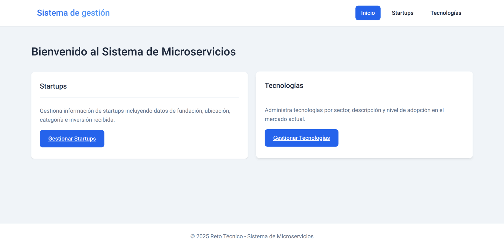
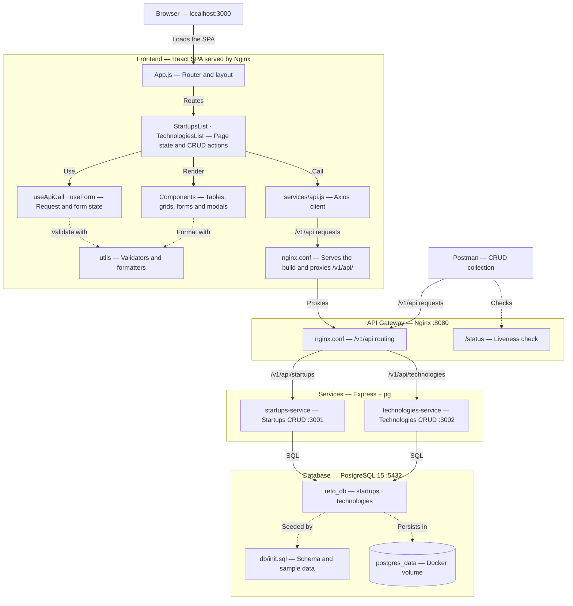

<h1 align="center">Microservices System</h1>

<p align="center">
  <i>Startup and emerging technologies management system built with a decoupled microservices architecture.</i>
</p>

<p align="center">
  
  
  
  
  
  
  
</p>

<p align="center">
  
</p>

---

## Introduction

Startup and emerging technologies management system built with a decoupled microservices architecture. Each domain is implemented as an independent microservice with its full CRUD, exposed through an Nginx API Gateway, with a responsive React frontend.

---

## Table of Contents

- [Introduction](#introduction)
- [Table of Contents](#table-of-contents)
- [Description](#description)
- [System Architecture](#system-architecture)
  - [Microservices](#microservices)
- [Project Structure](#project-structure)
- [Technology Stack](#technology-stack)
  - [Backend](#backend)
  - [Frontend](#frontend)
- [Prerequisites](#prerequisites)
  - [Installation verification](#installation-verification)
- [Installation and Execution](#installation-and-execution)
  - [Step 1: Clone the repository](#step-1-clone-the-repository)
  - [Step 2: Start services with Docker Compose](#step-2-start-services-with-docker-compose)
  - [Step 3: Verify that services are running](#step-3-verify-that-services-are-running)
  - [Step 4: Access the application](#step-4-access-the-application)
- [Environment Variables](#environment-variables)
- [API Routes](#api-routes)
  - [Base URL](#base-url)
  - [Startups Endpoints](#startups-endpoints)
    - [Example: Create startup](#example-create-startup)
  - [Technologies Endpoints](#technologies-endpoints)
    - [Example: Create technology](#example-create-technology)
  - [HTTP Status Codes](#http-status-codes)
- [Postman Testing](#postman-testing)
  - [Collection Overview](#collection-overview)
  - [Postman Collection](#postman-collection)
  - [Import](#import)
  - [Documented Test Cases](#documented-test-cases)
    - [Startups](#startups)
    - [Technologies](#technologies)
    - [Health Checks](#health-checks)
  - [Testing Examples](#testing-examples)
    - [Successful Startup Creation](#successful-startup-creation)
    - [Error Validation](#error-validation)
    - [Resource Listing](#resource-listing)
- [Data Model](#data-model)
  - [Table: startups](#table-startups)
  - [Table: technologies](#table-technologies)
- [Useful Commands](#useful-commands)
  - [Docker Compose](#docker-compose)
  - [Database](#database)
- [System Features](#system-features)
  - [Backend](#backend-1)
  - [Frontend](#frontend-1)
- [Troubleshooting](#troubleshooting)
  - [Services not responding](#services-not-responding)
  - [Database connection error](#database-connection-error)
  - [Frontend does not load data](#frontend-does-not-load-data)
  - [Port already in use](#port-already-in-use)
  - [Clean and rebuild](#clean-and-rebuild)
- [Author](#author)
- [License](#license)

---

## Description

Startup and emerging technologies management system built with a decoupled microservices architecture. Each domain is implemented as an independent microservice with its full CRUD, exposed through an Nginx API Gateway, with a responsive React frontend.

| Component | Description |
|----------|-------------|
| Domains | Startups and Emerging Technologies |
| Microservices | 2 independent services (1 per domain) |
| Gateway | Nginx as reverse proxy |
| Database | PostgreSQL 15 |
| Frontend | React 19 served by Nginx |

---

## System Architecture



### Microservices

**Startups:**
- startups-service (port 3001): create, read, update and delete startups on `/v1/api/startups`

**Technologies:**
- technologies-service (port 3002): create, read, update and delete technologies on `/v1/api/technologies`

Both services share the PostgreSQL database and only publish their ports inside the Docker network, so clients reach them through the API Gateway.

---

## Project Structure

```
Microservices-System/
├── gateway/
│   ├── nginx.conf              # API Gateway routes
│   └── Dockerfile              # API Gateway image
│
├── services/
│   ├── startups/
│   │   ├── index.js            # Startups CRUD microservice
│   │   ├── package.json
│   │   ├── package-lock.json
│   │   ├── Dockerfile
│   │   └── .dockerignore
│   │
│   └── technologies/
│       ├── index.js            # Technologies CRUD microservice
│       ├── package.json
│       ├── package-lock.json
│       ├── Dockerfile
│       └── .dockerignore
│
├── frontend/
│   ├── public/
│   │   └── index.html          # Main HTML
│   │
│   ├── src/
│   │   ├── components/
│   │   │   ├── common/
│   │   │   │   ├── Alert.js            # Alert component
│   │   │   │   ├── ConfirmDialog.js    # Confirmation dialog
│   │   │   │   ├── FormInput.js        # Reusable input
│   │   │   │   ├── FormSelect.js       # Reusable select
│   │   │   │   ├── Modal.js            # Generic modal
│   │   │   │   └── Spinner.js          # Loading indicator
│   │   │   │
│   │   │   ├── Startups/
│   │   │   │   ├── StartupForm.js      # Create/edit startup form
│   │   │   │   ├── StartupsFilters.js  # Search filters
│   │   │   │   ├── StartupsList.js     # Main container
│   │   │   │   └── StartupsTable.js    # Startups table
│   │   │   │
│   │   │   └── Technologies/
│   │   │       ├── TechnologiesFilters.js  # Search filters
│   │   │       ├── TechnologiesGrid.js     # Technologies grid
│   │   │       ├── TechnologiesList.js     # Main container
│   │   │       └── TechnologyForm.js       # Create/edit form
│   │   │
│   │   ├── hooks/
│   │   │   ├── useApiCall.js   # Hook for API calls
│   │   │   └── useForm.js      # Hook for form handling
│   │   │
│   │   ├── services/
│   │   │   └── api.js          # Axios client and API services
│   │   │
│   │   ├── utils/
│   │   │   ├── formatters.js   # Formatting functions
│   │   │   └── validators.js   # Form validations
│   │   │
│   │   ├── App.js              # Main component and routes
│   │   ├── App.css             # Global styles
│   │   └── index.js            # Entry point
│   │
│   ├── .dockerignore           # Files excluded from the image
│   ├── .env.example            # Environment variables template
│   ├── package.json            # Frontend dependencies
│   ├── package-lock.json       # Dependency lock
│   ├── nginx.conf              # Nginx configuration for frontend
│   └── Dockerfile              # Frontend image
│
├── db/
│   └── init.sql                # DB initialization script
│
├── .env.example                # Database variables template
├── .gitignore                  # Git ignored files
├── docker-compose.yml          # Container orchestration
├── Microservices_CRUD_Collection.postman.json  # Postman collection
└── README.md                   # This file
```

---

## Technology Stack

### Backend

| Technology | Version | Usage |
|-----------|---------|------|
| Node.js | 18 | Runtime |
| Express.js | 4.x | HTTP framework |
| PostgreSQL | 15 | Database |
| pg | 8.x | PostgreSQL client |
| cors | 2.x | CORS middleware |
| Nginx | Alpine | API Gateway |
| Docker | 20.10+ | Containers |
| Docker Compose | 2.x | Orchestration |

### Frontend

| Technology | Version | Usage |
|-----------|---------|------|
| React | 19 | UI framework |
| React Router DOM | 7.x | Routing |
| Axios | 1.x | HTTP client |
| React Scripts | 5.x | Build tooling |
| Node.js | 22 | Build stage |
| Nginx | Alpine | Static server and API proxy |
| CSS Variables | - | Global styles |

---

## Prerequisites

- Docker Desktop 20.10 or higher
- Docker Compose 2.x (included with Docker Desktop)
- Git
- Ports 3000, 8080 and 5432 available

### Installation verification

```bash
docker --version
docker compose version
```

---

## Installation and Execution

### Step 1: Clone the repository

```bash
git clone <repository-url>
cd Microservices-System
```

### Step 2: Start services with Docker Compose

```bash
cp .env.example .env
docker compose up --build -d
```

The `.env` file is optional; without it, Docker Compose uses the same default values.

This command:
- Builds the images for the 2 microservices
- Builds the API Gateway image
- Builds the frontend image
- Creates the PostgreSQL database
- Runs the init.sql script to create tables and insert test data
- Brings up all containers on the Docker network

The first build takes a few minutes because Docker downloads the base images and installs the dependencies.

### Step 3: Verify that services are running

```bash
docker compose ps
```

It should show 5 active containers:
- 1 frontend (`reto_frontend`)
- 1 gateway (`reto_gateway`)
- 2 microservices (`startups_service` and `technologies_service`)
- 1 postgres (`reto_db`)

### Step 4: Access the application

| Service | URL |
|--------|-----|
| Frontend | http://localhost:3000 |
| API Gateway | http://localhost:8080/v1/api |
| Gateway status | http://localhost:8080/status |
| PostgreSQL | localhost:5432 |

---

## Environment Variables

The root `.env` file configures the database and the gateway host port. If it does not exist, `docker-compose.yml` uses these default values:

```env
DB_NAME=reto_db
DB_USER=postgres
DB_PASSWORD=postgres123
GATEWAY_PORT=8080
```

Docker Compose passes these values to both microservices, together with:

| Variable | startups-service | technologies-service |
|----------|------------------|----------------------|
| DB_HOST | postgres | postgres |
| DB_PORT | 5432 | 5432 |
| SERVICE_PORT | 3001 | 3002 |

The frontend reads `REACT_APP_API_BASE_URL` from `frontend/.env` when it runs or is built locally with npm. Its default is `http://localhost:3000/v1/api`, which goes through the frontend Nginx proxy. To use the React development server against the gateway, set it to `http://localhost:8080/v1/api`.

---

## API Routes

### Base URL

```
http://localhost:8080/v1/api
```

IDs are integers from 1 to 2147483647. List routes return the newest records first and accept `limit` (default 50) and `offset` (default 0), both from 0 to 2147483647. Text filters are partial and case-insensitive, and they can be combined.

### Startups Endpoints

| Method | Endpoint | Description |
|-------|----------|-------------|
| POST | /v1/api/startups | Create startup |
| GET | /v1/api/startups | List startups |
| GET | /v1/api/startups/:id | Get startup by ID |
| GET | /v1/api/startups?name=X | Filter by name |
| GET | /v1/api/startups?category=X | Filter by category |
| GET | /v1/api/startups?location=X | Filter by location |
| PUT | /v1/api/startups/:id | Update startup |
| DELETE | /v1/api/startups/:id | Delete startup |

#### Example: Create startup

```http
POST /v1/api/startups
Content-Type: application/json

{
  "name": "TechVision AI",
  "foundedAt": "2023-01-15",
  "location": "Mexico City, MX",
  "category": "AI/ML",
  "fundingAmount": 5000000
}
```

`name`, `foundedAt`, `location` and `category` are required. `foundedAt` must be a real date in `YYYY-MM-DD` format, and `fundingAmount` is optional, cannot be negative and defaults to 0.

Response (201 Created):

```json
{
  "message": "Startup created successfully",
  "data": {
    "id": 4,
    "name": "TechVision AI",
    "founded_at": "2023-01-15T00:00:00.000Z",
    "location": "Mexico City, MX",
    "category": "AI/ML",
    "funding_amount": "5000000.00",
    "created_at": "2026-10-08T21:33:34.991Z",
    "updated_at": "2026-10-08T21:33:34.991Z"
  }
}
```

Updates are partial: `PUT` accepts any of the create fields and only changes the ones sent.

### Technologies Endpoints

| Method | Endpoint | Description |
|-------|----------|-------------|
| POST | /v1/api/technologies | Create technology |
| GET | /v1/api/technologies | List technologies |
| GET | /v1/api/technologies/:id | Get technology by ID |
| GET | /v1/api/technologies?name=X | Filter by name |
| GET | /v1/api/technologies?sector=X | Filter by sector |
| GET | /v1/api/technologies?adoptionLevel=X | Filter by adoption level |
| PUT | /v1/api/technologies/:id | Update technology |
| DELETE | /v1/api/technologies/:id | Delete technology |

#### Example: Create technology

```http
POST /v1/api/technologies
Content-Type: application/json

{
  "name": "Quantum Computing",
  "sector": "Computing",
  "description": "Computing using quantum mechanics",
  "adoptionLevel": "emerging"
}
```

`name`, `sector` and `adoptionLevel` are required, and `description` is optional. Valid values for `adoptionLevel`: emerging, growing, mature, declining. The `adoptionLevel` filter must match one of these values exactly.

### HTTP Status Codes

| Code | Description |
|--------|-------------|
| 200 | OK - Successful read, update or deletion |
| 201 | Created - Resource created |
| 400 | Bad Request - Invalid data, ID or pagination |
| 404 | Not Found - Resource or endpoint not found |
| 500 | Internal Server Error |

Error responses include an `error` message.

---

## Postman Testing

### Collection Overview

The `Microservices_CRUD_Collection.postman.json` file contains 18 requests with 37 assertions, grouped in three folders: Startups (10), Technologies (7) and Health Checks (1). Every request checks the status code and the JSON response, and the create requests store the new IDs for the requests that follow.

### Postman Collection

| Variable | Default |
|----------|---------|
| `baseUrl` | `http://localhost:8080/v1/api` |
| `gatewayUrl` | `http://localhost:8080` |
| `missingStartupId` | `2147483647` |
| `missingTechnologyId` | `2147483647` |

The missing IDs must not exist in the database. To test through the frontend proxy, set `baseUrl` to `http://localhost:3000/v1/api`.

### Import

1. Open Postman
2. File > Import
3. Select `Microservices_CRUD_Collection.postman.json`
4. Run the collection in order with the Collection Runner

### Documented Test Cases

Endpoints are relative to `baseUrl`, except `/status`, which uses `gatewayUrl`.

#### Startups

| Test | Request | Endpoint | Method | Expected Status |
|------|---------|----------|--------|-----------------|
| 01 | Create Startup | /startups | POST | 201 |
| 02 | Create Startup - Invalid (Missing Fields) | /startups | POST | 400 |
| 03 | Get All Startups | /startups | GET | 200 |
| 04 | Get Startups with Filters | /startups?category=AI/ML&name=Tech | GET | 200 |
| 05 | Get Startup by ID | /startups/:id | GET | 200 |
| 06 | Get Startup - Invalid ID | /startups/2147483647 | GET | 404 |
| 07 | Update Startup | /startups/:id | PUT | 200 |
| 08 | Update Startup - Invalid Data | /startups/:id | PUT | 400 |
| 09 | Delete Startup | /startups/:id | DELETE | 200 |
| 10 | Delete Startup - Non Existent | /startups/2147483647 | DELETE | 404 |

#### Technologies

| Test | Request | Endpoint | Method | Expected Status |
|------|---------|----------|--------|-----------------|
| 11 | Create Technology | /technologies | POST | 201 |
| 12 | Create Technology - Invalid | /technologies | POST | 400 |
| 13 | Get All Technologies | /technologies | GET | 200 |
| 14 | Get Technologies with Filters | /technologies?sector=FinTech&adoptionLevel=growing | GET | 200 |
| 15 | Get Technology by ID | /technologies/:id | GET | 200 |
| 16 | Update Technology | /technologies/:id | PUT | 200 |
| 17 | Delete Technology | /technologies/:id | DELETE | 200 |

#### Health Checks

| Test | Request | Endpoint | Method | Expected Status |
|------|---------|----------|--------|-----------------|
| 18 | Gateway Health | /status | GET | 200 |

### Testing Examples

#### Successful Startup Creation

The Create Startup request sends the body from [Example: Create startup](#example-create-startup) and runs these tests:

```javascript
pm.test("HTTP 201", () => pm.response.to.have.status(201));
pm.test("JSON response", () => pm.response.to.be.json);
if (pm.response.code === 201) pm.collectionVariables.set("startupId", pm.response.json().data.id);
```

The stored `startupId` is used by the read, update and delete requests.

#### Error Validation

```http
POST /v1/api/startups
Content-Type: application/json

{
  "name": "Incomplete Startup"
}
```

Response (400 Bad Request):

```json
{
  "error": "Missing required fields",
  "required": ["name", "foundedAt", "location", "category"]
}
```

#### Resource Listing

```http
GET /v1/api/startups?limit=2
```

Response (200 OK):

```json
{
  "data": [
    {
      "id": 4,
      "name": "TechVision AI",
      "founded_at": "2023-01-15T00:00:00.000Z",
      "location": "Mexico City, MX",
      "category": "AI/ML",
      "funding_amount": "5000000.00",
      "created_at": "2026-10-08T21:33:34.991Z",
      "updated_at": "2026-10-08T21:33:34.991Z"
    },
    {
      "id": 1,
      "name": "TechStart Alpha",
      "founded_at": "2020-01-15T00:00:00.000Z",
      "location": "San Francisco, CA",
      "category": "AI/ML",
      "funding_amount": "5000000.00",
      "created_at": "2026-10-08T21:33:17.349Z",
      "updated_at": "2026-10-08T21:33:17.349Z"
    }
  ],
  "pagination": {
    "total": 4,
    "limit": 2,
    "offset": 0,
    "hasMore": true
  }
}
```

---

## Data Model

### Table: startups

| Field | Type | Constraints |
|-------|------|-------------|
| id | SERIAL | PRIMARY KEY |
| name | VARCHAR(255) | NOT NULL |
| founded_at | DATE | NOT NULL |
| location | VARCHAR(255) | NOT NULL |
| category | VARCHAR(100) | NOT NULL |
| funding_amount | DECIMAL(15,2) | DEFAULT 0 |
| created_at | TIMESTAMP | DEFAULT CURRENT_TIMESTAMP |
| updated_at | TIMESTAMP | DEFAULT CURRENT_TIMESTAMP |

Indexes on `name` and `category`. The init script inserts 3 sample startups.

### Table: technologies

| Field | Type | Constraints |
|-------|------|-------------|
| id | SERIAL | PRIMARY KEY |
| name | VARCHAR(255) | NOT NULL |
| sector | VARCHAR(100) | NOT NULL |
| description | TEXT | - |
| adoption_level | VARCHAR(50) | NOT NULL, CHECK (emerging, growing, mature, declining) |
| created_at | TIMESTAMP | DEFAULT CURRENT_TIMESTAMP |
| updated_at | TIMESTAMP | DEFAULT CURRENT_TIMESTAMP |

Indexes on `sector` and `adoption_level`. The init script inserts 3 sample technologies.

---

## Useful Commands

### Docker Compose

```bash
# Start services in the background
docker compose up -d

# Start with rebuild
docker compose up --build -d

# Stop services
docker compose down

# View logs for all services
docker compose logs -f

# View logs for a specific service
docker compose logs -f gateway

# View container status
docker compose ps

# Restart a service
docker compose restart startups-service

# Remove volumes (includes DB data)
docker compose down -v
```

### Database

```bash
# Connect to PostgreSQL
docker exec -it reto_db psql -U postgres -d reto_db

# List tables
\dt

# View startups data
SELECT * FROM startups;

# View technologies data
SELECT * FROM technologies;

# Exit
\q
```

---

## System Features

### Backend

- 2 independent microservices, one per domain, each with its full CRUD
- Nginx API Gateway with route versioning (/v1/api)
- PostgreSQL with indexes and sample data
- Input validation for required fields, dates, IDs, pagination and adoption levels
- Consistent error handling with appropriate HTTP codes
- Pagination and combinable filters on list endpoints
- /status endpoint on the gateway for monitoring
- CORS configured
- Docker Compose orchestration with a PostgreSQL healthcheck

### Frontend

- Full CRUD for both domains
- Dynamic filters (name, category, sector, adoption level)
- Client-side validation before submitting
- Success and error messages
- Loading indicators during requests
- Confirmation dialog before deleting
- Responsive design with a mobile menu
- Reusable components
- Custom hooks (useForm, useApiCall)
- Routing with React Router
- Nginx proxy from /v1/api/ to the API Gateway

---

## Troubleshooting

### Services not responding

```bash
# Check container status
docker compose ps

# Check logs to identify errors
docker compose logs

# Restart all services
docker compose down
docker compose up --build -d
```

### Database connection error

```bash
# Verify PostgreSQL is running
docker compose ps postgres

# View PostgreSQL logs
docker compose logs postgres

# Wait for the healthcheck to pass and verify again
docker compose up -d
docker compose ps
```

### Frontend does not load data

1. Verify the API Gateway is running: http://localhost:8080/status
2. Check gateway logs: `docker compose logs gateway`
3. Verify the microservices respond: `docker compose logs startups-service technologies-service`
4. Open the frontend at http://localhost:3000 on the same machine, because the React build sends its requests to `http://localhost:3000/v1/api`

### Port already in use

```bash
# See which process is using the port (Linux/macOS)
lsof -i :8080

# See which process is using the port (Windows PowerShell)
netstat -ano | findstr :8080

# Check ports published by running Docker containers
docker ps --format 'table {{.Names}}\t{{.Ports}}'
```

If port 8080 belongs to another application, set `GATEWAY_PORT=8081` in the root `.env` file and run `docker compose up -d` again. The gateway will be available at `http://localhost:8081`; update Postman's `baseUrl` to `http://localhost:8081/v1/api` and `gatewayUrl` to `http://localhost:8081`. The Docker frontend continues to reach the gateway through the internal Docker network.

`docker compose down` only stops this project's containers; it cannot free a port held by another project. If port 5432 is occupied, change the database host port in `docker-compose.yml` (for example `"5433:5432"`). Keep port 3000 for the frontend, because the React build sends its requests to that port.

### Clean and rebuild

```bash
# Remove containers, networks, volumes and project images
docker compose down -v --rmi local

# Rebuild from scratch
docker compose up --build -d
```

---

## Author

Carlos Elias Linares Ojeda

---

## License

This project was developed as part of a technical challenge.
